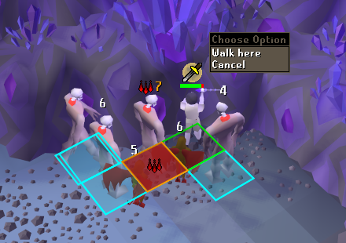
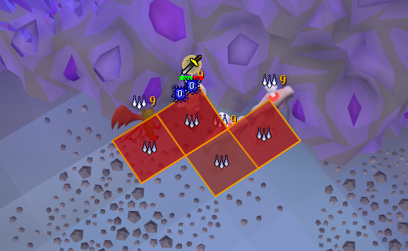
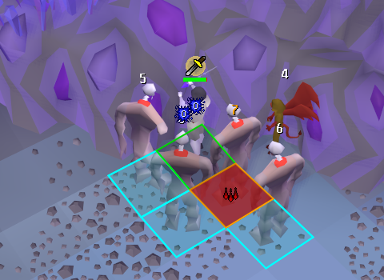

# Barrage Indicator

Shows, on each pile of monsters of your slayer task, how many of them one burst or barrage cast there would hit, and puts the spell icon on the pile where it hits the most. It works the same with chinchompas in hand.

*Each number is how many monsters one cast on that monster would hit. The red tile is the south-west tile of the best monster to cast on, with the spell icon on it.*

- A burst or barrage hits a 3x3 area centred on the south-west tile of its target, and every monster whose own south-west tile is inside that area, up to nine in all. A large monster counts by its south-west tile alone: two 2x2 monsters side by side are not hit together.
- A monster in that area is counted only when the target has line of sight to it: scenery between the two keeps the spell from reaching it. The game's own collision map is used. Monsters standing on top of each other (a pile on one tile) are always hit together.
- Chinchompas (grey, red and black) hit the same 3x3 area, up to 11 monsters, 12 with black ones (OSRS Wiki, Chinchompa). Holding them, the count goes up to that, and the best pile is the best within their reach.
- The count is redone every game tick from where the monsters stand.
- The best pile is the best one you can cast on without walking (walking undoes the pile): within the spell's 10 squares (9 for chinchompas, 10 on long fuse), measured to the monster's closest tile, and in line of sight from you. Another player's pile further away is not marked. With no pile in reach, the largest of all is marked. Every pile still shows its number.
- By default it only runs on Ancient Magicks or with chinchompas in hand, in multicombat, and for the monsters of your current slayer task (the task name is the one RuneLite's Slayer plugin saves; tasks whose name is not a plain plural of their monsters, like Jellies, Lizardmen, Elves or Aberrant spectres, carry their monsters' names, taken from the OSRS Wiki). "Other monsters" adds names by hand.
- The spell hits every monster you can attack, up to nine, not only those of your task: Death spawn among Greater Nechryael take up some of the nine. "Count monsters not on task" (off by default) counts them too; the marks stay on the monsters of your task. Off, only the monsters of your task are counted.

*A full pile: every cast hits nine, so every one of the best is marked.*

*With chinchompas in hand, the chinchompa is the icon, drawn on the tile to cast on.*

## What it never does

- It does not click, cast, or change any menu. It only draws.
- It says nothing about what a monster will do, and with the default settings it stays off outside a slayer task.

## Settings

Only my slayer task, count monsters not on task, other monsters by name, only with Ancients or chinchompas, only in multicombat, smallest pile to mark (2 to 9), number on every pile or only the best, spell icon, the south-west tile of the monster to cast on filled in red with the spell icon on it (every one of the best, with a tie), tile outline, colours and number size.

The icon is the burst or barrage spell you have on autocast, or Ice Barrage when none is; with chinchompas in hand, the chinchompa. It is drawn once: on the tile to cast on while that tile is marked (the default), otherwise over the best pile. Only monsters are counted and marked, never players.

In the Smoke Devil Dungeon three tiles are marked around the bones west of the cannon spot ("Group N", "Group W", "Group S"): with the cannon in the middle of the room, run from one to another to pile the smoke devils up beside the bones (OSRS Wiki, Smoke devil/Strategies, "Grouping"). Can be turned off.

## Bug or suggestion

Click "Bug or suggestion" in the plugin's settings: it opens a window where you write what is wrong or what you would like. Under your words it shows exactly what goes with them: the plugin's name, the monster you were fighting, the ids of the items you wear and carry, and the map region. No name of yours or of your account.

- "Send the report" sends it to the author's Google Form. Nothing is sent until you press it.
- "Open the report on GitHub" opens a new issue with the text filled in, for you to post.
- "Copy the report" puts it on the clipboard.
